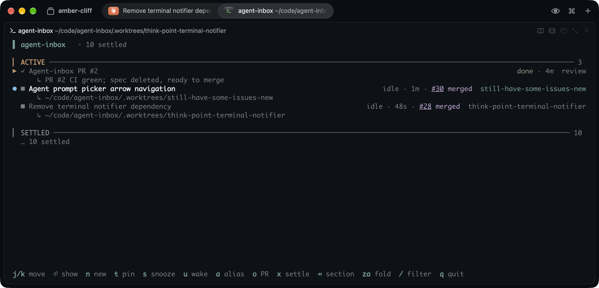

# agent-inbox

A triage inbox for coding agents (Claude Code, Codex, agy) running in
[Rex](https://www.superlogical.com/rex/docs/). It sorts them into needs you,
active, pinned, snoozed and settled, starts new ones in worktrees, and
follows their pull requests.



## Install

Requires Rex, and `gh` for pull requests.

```
brew trust jordanbyron/tap
brew install jordanbyron/tap/agent-inbox
```

Or from a checkout, `go install ./cmd/agent-inbox`.

## Commands

```
agent-inbox                 the list
agent-inbox --modal         the list, closing on Esc or once it shows an agent
agent-inbox new             the new-agent form, or flags for scripts
agent-inbox open|snooze|wake|pin|settle|restore|alias|link|delete [AGENT]
agent-inbox ls --json       the rows, for other tools
agent-inbox reap [--dry-run]
agent-inbox lua             Rex actions to paste into init.lua
agent-inbox watch           the watcher (started for you)
```

A verb with no agent acts on the agent in the current Rex block. The
snippet's `agent_inbox_menu` action lists the commands in Rex's palette, and
`agent_inbox_modal` shows the list over the current tab and focuses it. If
the list is already open there, behind your work or minimized, it comes
forward instead; pressed inside the list, the action closes it.

A new agent's tab opens with the list parked in a narrow pane on its left.
The agent the tab holds leads that list, under This tab. The modal shows
the whole inbox without that group.
`agent_inbox_beside` parks it the same way in any tab, or removes it.
Settling an agent closes its tab, parked list and all.

## Keys

| Key | Action |
|---|---|
| `j` `k` | move down / up |
| `gg` `G` | first / last row |
| `Ctrl-d` `Ctrl-u` | half page down / up (`Ctrl-f` `Ctrl-b` full page) |
| `Enter` `l` | show the agent's tab, or open the fold |
| `Tab` `Shift+Tab` | next / previous section |
| `h` | close the fold |
| `za` `zo` `zc` | toggle / open / close the fold under the cursor |
| `n` | new agent |
| `t` | pin / unpin |
| `s` | snooze: `1` 15m · `2` 1h · `3` tomorrow 9am · `4` until woken · `5` custom |
| `u` | wake a snoozed agent, or restore a settled one |
| `x` | settle: close its tab |
| `a` | set an alias |
| `o` | open the pull request in the browser |
| `y` | copy the pull request's link |
| `P` | link a pull request by hand (empty clears) |
| `Ctrl-x` | delete the family, its worktrees and branches (asks `y` first) |
| `/` | filter; `Esc` clears |
| `R` | relaunch, once a pill says a new agent-inbox is installed |
| `q` | quit (`Esc` too, with `--modal`) |

## Config

`~/.config/agent-inbox/config.toml`:

```toml
sort = "default"            # or "activity"
fold_working = false        # agents at work go under Working
reap = false                # delete families settled for 14 days

[worktree]
default = true
path    = "{repo}/.worktrees/{name}"
branch  = "{name}"
base    = "fresh"           # or "head"

[recipes.NAME]              # a harness of your own, or one replacing claude, codex or agy
app     = "my-agent"        # the app its OSC 7501 status names
start   = ["my-agent", "--", "{prompt}"]
resume  = ["my-agent", "--resume", "{session_id}"]
mention = "@{path}"
```

Rex sends the notifications when an agent needs you or finishes; agent-inbox
sends none of its own. Reap leaves pinned and snoozed families, and any
worktree with uncommitted or unpushed work, alone.

[CONTRIBUTING.md](CONTRIBUTING.md) covers working on agent-inbox, and
[docs/rex-quirks.md](docs/rex-quirks.md) records what Rex and the harnesses
were seen to do.
